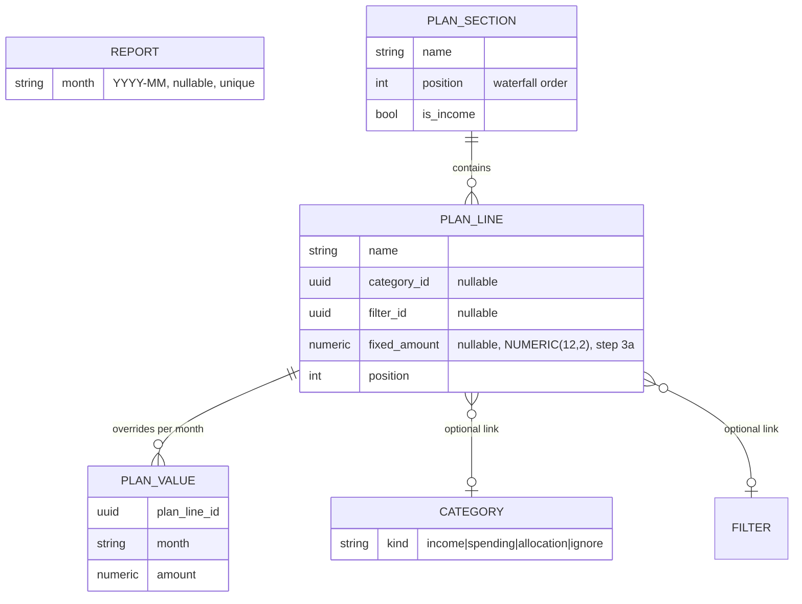

# Monthly Plan & Summary Features

> **Phases 2 and 3 (steps 7–14) are superseded** by [2026-09-06-month-breakdown-mvp](../2026-09-06-month-breakdown-mvp/plan.md), which ships the month-by-month actuals view (`/breakdown`) on its own — explicit report months, always-expanded category/filter rows, automatic month columns — without the plan-vs-actual columns, month-range picker and category kinds designed here. Follow that folder for actuals month columns; the steps below retain the original reporting design rationale. **Phase 1 (steps 1–6, the `/plan` grid) still stands.**

> **Current scope:** Step 3a (fixed monthly amounts and section totals) is committed in `0d5dc98`. Step 3b (read-only month columns and range controls) is committed; implementation and acceptance are complete; deletion is user-verified and the user explicitly skipped slow-request and failed-save browser checks. The [Step 3 spec](step-03-month-columns-fixed-defaults.md) defines the active contract. Overrides, left-over rows, percentages, and category/filter links below remain roadmap context.

Expand the spending tracker with two features: a monthly planning grid (replacing the budget Google Sheet) and a month-by-month plan-vs-actual summary grid (replacing the summary Google Sheet), built on the existing category/filter taxonomy.

## Decisions made together

- Reports get a **month** field; one report = one month (unique constraint); existing reports get backfilled by hand in the UI.
- Categories get a **kind**: `income | spending | allocation | ignore` (Investments and Savings are allocation; used for FINAL / SPENDING / SPENDING %).
- Plan lines optionally link to a category (e.g. Food) or a filter (e.g. Mortgage); unlinked lines (Split) exist too and stay plan-page-only.
- Line defaults: fixed cash amount, or a percentage of the left-over row above the line's section (for the first section after income, that's total income). Percentages recompute **live**; a manual cell edit overrides the default for that month only.
- Summary rows = the actuals taxonomy (categories with filter breakdown). Submitted months show Plan and Actual columns with a toggle (both / plan only / actual only); future or report-less months show plan only.
- Flat 2-level structure (category → filter) is enough; no sub-groups.
- The income section is marked with an explicit `is_income` flag on plan sections (not a position convention).
- Uncategorized transactions appear in the summary as an **Unidentified** row per month, counted in FINAL / SPENDING — totals always reflect real money out.
- A month whose report exists but was never generated (`report.data` null) is treated as having **no actuals**: plan-only column in the summary.
- Grid tech: the `/plan` grid is a hand-rolled table (mixed row types don't fit AG Grid Community); `/summary` uses AG Grid.
- Build order: plan feature first, then summary; many small vertical slices, each committable and visible in the UI.

## Schema changes ([backend/app/db/models.py](../../../backend/app/db/models.py) + Alembic migrations)

Migrations are created incrementally, one per build step that needs new schema (see build order below). Step 3a stores only `fixed_amount`; it does not introduce `default_kind` or `default_value`. Percentage storage and its migration are deferred to step 6. The other future relationships in this sketch are not added by step 3a. `plan_value` stores only manual entries/overrides — recurring amounts are resolved from the saved row default, not copied into every month. The historical `category.kind` proposal belongs to the superseded reporting phases.

## Backend (follow existing repository/service/route layering)

- **Reports**: accept `month` on create and PATCH; expose in responses.
- **Categories**: accept `kind` on create/PATCH.
- **Plan** (new `plan_routes.py`, `plan_service.py`, repository):
  - Step 3a added nullable `fixed_amount` to line responses and `PATCH /plan/lines/{id}`. Step 3b adds `GET /plan?from=YYYY-MM&to=YYYY-MM`: ordered months and sections/lines, per-line `amounts`, and section `totals` keyed by month. Totals use backend `Decimal`; the page no longer calculates them. Section/line CRUD remains available.
  - Future steps extend section/line CRUD with category/filter links and percentage defaults.
  - Step 4 adds `PUT /plan/lines/{id}/values/{month}` to set an override and `DELETE` to revert to default.
  - Steps 4–6 extend the grid builder in `plan_service` with overrides, `is_override`, computed left-over, and percentage resolution. These fields and calculations are not part of 3b.
- **Summary** (new `summary_routes.py`, `summary_service.py`):
  - `GET /summary?from&to` returns, per month: plan values mapped onto linked categories/filters (summing when several lines share a target), and (if a **generated** report with that month exists) actuals aggregated from `report.data` mapped to live taxonomy by stable identity (`rule_filter_id` / manual-filter `category_id`), plus an Unidentified row, excluding income/ignore rows; plus FINAL, SPENDING, SPENDING % computed from category kinds. Amounts keep DB sign; the frontend flips at parse time.

## Frontend (TanStack Router, backendClient + Zod, TanStack Query, hand-rolled plan grid, AG Grid summary)

- **Report upload/detail**: month picker on [ReportUploadPage.tsx](../../../frontend/src/components/ReportUploadPage.tsx); editable month on [ReportDetailPage.tsx](../../../frontend/src/components/report-detail/ReportDetailPage.tsx) for backfilling existing reports.
- **`/plan` page**: CSS grid with read-only month columns, sticky names/actions, ordered sections/lines, and per-month totals. From/To controls default to the current local month plus five; ranges are inclusive, limited to 120 months, and not persisted. Row editing changes the recurring default. Cell overrides, left-over rows, percentages, and category/filter links come later.
- **`/summary` page**: AG Grid — months as columns (two sub-columns Plan | Actual for submitted months, one Plan column otherwise), category rows expandable to filters, FINAL/SPENDING/SPENDING % pinned at bottom, toggle for both/plan-only/actual-only.
- Sidebar ([AppSidebar.tsx](../../../frontend/src/components/AppSidebar.tsx)): links to Plan and Summary.

## Build order

Vertical slices: every step is committable, introduces no dead code, and ends with something visible in the UI. Migrations are added only in the step that first uses the schema. Plan feature first, then report months, then summary.

**Tracking progress:** each step heading carries a status tag — `[PENDING]`, `[IN PROGRESS]`, `[IMPLEMENTED]` (verified locally, not yet committed), or `[COMMITTED]`. Update the tag when starting, completing verification, or committing a step, and append notes under a step if the implementation deviated from the description. Status updates do not authorize staging or committing.

**For implementers:** each step links to a self-contained spec file in this folder. Read [conventions.md](conventions.md) (codebase patterns, workflow) plus the step file before starting; the step files assume no other context.

### Phase 1 — Plan grid

#### [Step 1 — Plan sections](step-01-plan-sections.md) [COMMITTED]

Migration: `plan_section` (name, position, is_income). CRUD API + new `/plan` page (sidebar link) listing sections as rows with add / rename / reorder / delete, income section marked.

**Post-step refactor** (do before or alongside Step 2):

- [x] Split `PlanPage.tsx` into `SectionRow` + `CreateSectionForm` components with a `usePlanSectionsState` hook.
- [ ] (BEHAVIOR CHANGE) Backport plan's stricter input validation to category/filter schemas (trimmed non-empty names, `position >= 1` + upper-bound check) — siblings can still persist blank names and position gaps that plan rejects. Separate commit.
- [ ] (BEHAVIOR CHANGE) Route category/filter client mutations through `parseAxiosError` — they surface raw Axios messages while report/plan mutations show the backend `detail`. Separate commit.

Deferred by choice: `update_plan_section` taking an entity instead of an id (avoids a double fetch for position validation); plan's `APIRouter(prefix="/plan")` style vs siblings' bare routers (forward-compatible with `GET /plan?from&to`).

#### [Step 2 — Plan lines](step-02-plan-lines.md) [COMMITTED]

Migration: `plan_line` (section FK, name, position). CRUD API + UI to manage lines within sections on the plan page.

Committed and pushed on 2026-10-29 in `8f082e2` (Add editable rows within plan sections). Row add/rename/reorder/delete and persistence are user-verified. Creation forms for both sections and rows open from “+ Add” buttons and close on save or cancel. Reordering stays within a section, and deleting a section cascades to its rows.

Verification: 46 plan API tests (24 row cases plus 22 section regressions) and 2 frontend response-parser tests passed, along with backend/frontend lint, formatting, type checks, and the frontend build. The existing bundle-size warning remains. See [step 2 verification](step-02-plan-lines.md#verification) for the focused commands. Next feature slice: step 3a, fixed amounts and section totals.

#### [Step 3a — Fixed amounts + section totals](step-03-month-columns-fixed-defaults.md#step-3a--fixed-amounts-and-section-totals-committed) [COMMITTED]

Migration: add nullable `fixed_amount NUMERIC(12,2)` to `plan_line`, preserving existing rows as unset. Edit or clear the amount in the existing row form and show section totals from saved amounts. This slice retained `GET /plan/sections` and `PLAN_SECTIONS_QUERY_KEY`; 3b supersedes the page query and frontend totals. Storage migration `892cb40c7a90` and the backend contract are implemented: all 69 Plan API tests pass. The frontend amount boundary, row editor, section totals, and shared pending guard for row saves are implemented; all 52 frontend contract tests pass. The user confirmed the row editor, total, and placement below the add-row controls. The automated checkpoint passes: 216 backend tests, 59 frontend tests, root `make lint`, and the frontend build. No formatting changes were needed; the existing bundle-size warning remains. Final browser checks for drafts, Cancel, clear/zero, reload, and invalid input passed. The user explicitly waived slow-network, failed-save recovery, and narrow-screen checks; these remain unverified rather than passed. User acceptance is complete; committed and pushed in `0d5dc98` (Add fixed monthly plan amounts and section totals). Migration round-trips were verified on a disposable database; the local development database was upgraded to `892cb40c7a90` on 2026-11-03 and `GET /plan/sections` returned 200 with amount fields present.

#### [Step 3b — Month columns](step-03-month-columns-fixed-defaults.md#step-3b--month-columns-committed) [COMMITTED]

Management verification passed on 2026-11-05: section/row creation, rename, reordering, recurring values/totals, and reload. Temporary records were removed and original Plan data verified unchanged. The user confirmed deletion works and explicitly skipped slow-request guards and failed-save recovery; see the [final browser outcomes](step-03-month-columns-fixed-defaults.md#final-browser-outcomes). Those two checks are skipped, not passed.

Final browser check (2026-11-04): at 390px width, even with the sidebar collapsed, the sticky name/actions column covers the visible grid and hides month values during horizontal scrolling. Fixed on 2026-11-05 with container-based sticky behavior: below `36rem`, names/actions scroll with the month columns; wider grids retain sticky names. The focused mobile and desktop checks passed. Final acceptance is complete with the explicit omissions recorded above.

Committed: validated computed-grid endpoint, backend Decimal totals, one range-keyed query with mutation invalidation, read-only month columns, sticky names/actions, and From/To controls. No new storage or monthly copies. The automated checkpoint passed on 2026-11-04: 242 backend tests, 97 frontend tests, root `make lint`, and the frontend build. All 68 named feature tests are green. Formatting made no changes; the existing bundle-size warning remains. Focused browser checks passed under explicit user authorization; the final browser checklist is resolved with two user-approved skips. See the [verification record](step-03-month-columns-fixed-defaults.md#verification-so-far). The compact Add row control sits beside Monthly total and expands its form on demand. Step 3b is complete; step 4 requires separate authorization.

#### [Step 4 — Per-month overrides](step-04-per-month-overrides.md) [PENDING]

Migration: `plan_value`. Click a cell to enter/edit a value for that month; overridden cells visually distinct with revert-to-default. `GET /plan?from&to` returns resolved amounts + `is_override`.

#### [Step 5 — Waterfall](step-05-waterfall.md) [PENDING]

Computed "Left over" row after each non-income section (income total minus sections above). Backend `plan_service` owns the computation.

#### [Step 6 — Percent defaults](step-06-percent-defaults.md) [PENDING]

Design percentage storage and migrate existing fixed amounts without changing their meaning. A percentage default computes live from the left-over amount before its section (total income for the first section after income). Overrides from step 4 still win; no percentage enum or value column is pre-created in step 3a.

### Phase 2 — Report months

#### [Step 7 — Month on existing reports](step-07-report-month.md) [PENDING]

Migration: `report.month` (nullable, unique). PATCH support + editable month field on the report detail page; month shown next to reports in the sidebar. Backfill existing reports by hand here.

#### [Step 8 — Month on upload](step-08-upload-month.md) [PENDING]

`POST /reports` accepts month; month picker on the upload page.

### Phase 3 — Summary

#### [Step 9 — Actuals summary v1](step-09-actuals-summary.md) [PENDING]

New `/summary` page (sidebar link): months as columns, one column per month, category totals aggregated from each month's report. `GET /summary?from&to`.

#### [Step 10 — Filter breakdown](step-10-filter-breakdown.md) [PENDING]

Category rows expand to show per-filter actuals.

#### [Step 11 — Category kinds](step-11-category-kinds.md) [PENDING]

Migration: `category.kind` (defaults per mapping above) + kind selector in the categories panel. Summary now excludes income/ignore rows and gains pinned FINAL / SPENDING / SPENDING % rows.

#### [Step 12 — Plan line links](step-12-plan-line-links.md) [PENDING]

Migration: add nullable `category_id` / `filter_id` to `plan_line` + link picker in the plan page's line settings. (Deferred to here so the links are used immediately by the next step.)

#### [Step 13 — Plan in summary](step-13-plan-in-summary.md) [PENDING]

Reported months show Plan | Actual sub-columns (plan mapped via line links); months without a report show a single Plan column.

#### [Step 14 — View toggle](step-14-view-toggle.md) [PENDING]

Page-level toggle: both / plan only / actual only.
